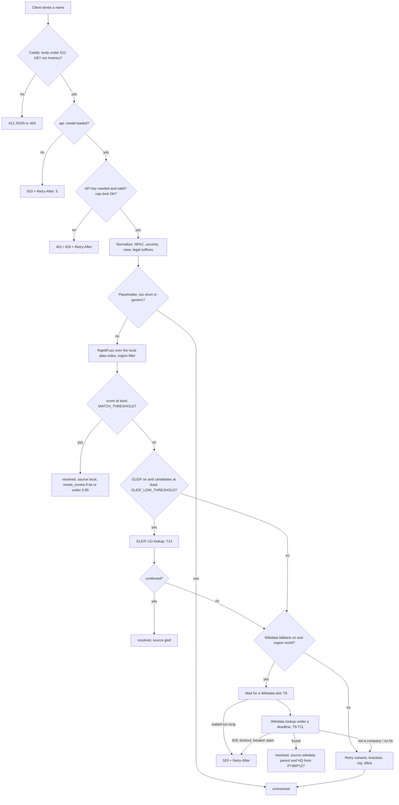
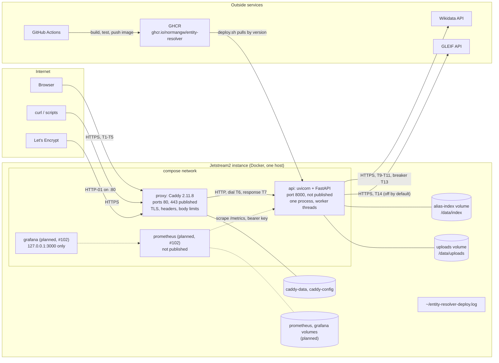
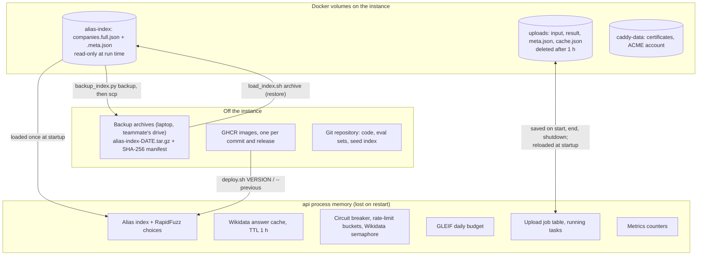
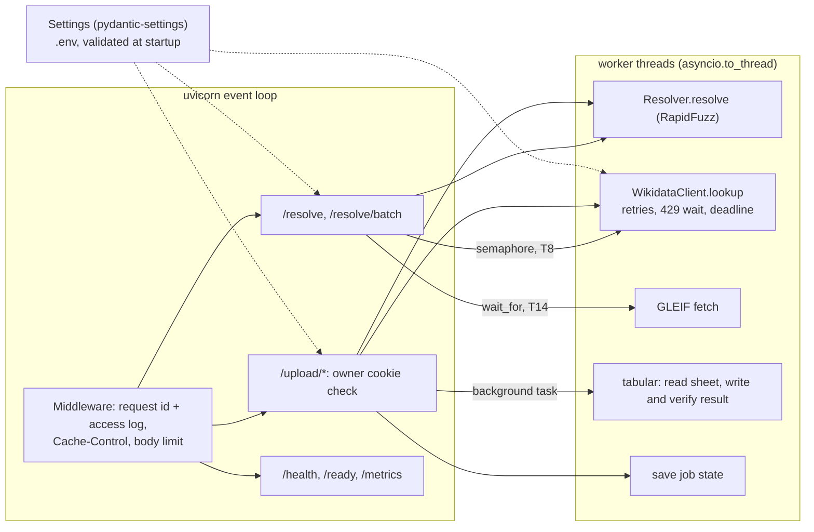
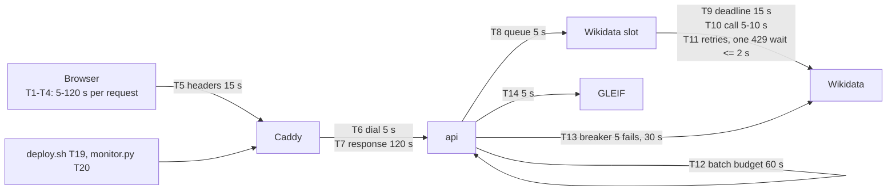

# Architecture

This document supersedes the Deliverable 2 snapshot in `docs/deliverable2/`
(which still shows nginx, port 8000 and `WRatio` at 0.8). The diagrams are Mermaid;
GitHub renders them in place. Numbers in square brackets, such as **[T7]**, are rows
of the [time-limits table](time-limits.md).

Parts marked *(planned, #102)* are Prometheus and Grafana, which the observability
work adds; they are drawn so the picture is complete, and are not in `compose.yml`
yet.

<!-- TODO(#106): export each diagram to SVG/PNG (mermaid-cli: npx @mermaid-js/mermaid-cli -i docs/architecture.md) if the slides need images. -->

## 1. Process view: one name, start to finish

What happens for `POST /resolve`. The spreadsheet flow runs the same resolver for
each unique name in a background task.

## 2. Execution view: what runs where

Only the proxy publishes ports. The api trusts the client address Caddy writes into
`X-Forwarded-For`. Grafana, once added, listens on loopback and is reached through
`ssh -L 3000:localhost:3000`.

## 3. State view: what is kept, where, and for how long

There is no database. The only state worth backing up is the alias index; uploads
are temporary on purpose, certificates can be issued again, and the image is
rebuilt from Git. Job files are read leniently (unknown fields ignored, missing
ones defaulted), so the old and new versions can read each other's files during a
rollback. Jobs expire after an hour, so no numbered migrations are needed.

## 4. Technical view: inside the api

| Part | Code | Notes |
|---|---|---|
| Web service | `main.py` | FastAPI app, routes, lifespan (loads the index in the background) |
| Settings | `config.py` | `ENVIRONMENT` profiles; bad values stop the app at startup |
| Matching | `resolver.py` | Normalization, RapidFuzz scorer (`SCORER`), tie rules, variants |
| Wikidata | `wikidata.py` | Search, entity fetch, parent and HQ rules, cache, breaker, deadline |
| GLEIF | `gleif.py` | LEI tiebreak, daily budget |
| Uploads | `uploads.py`, `tabular.py` | Job store, CSV/XLSX/XLS reading, formula neutralizing, output checks |
| Protection | `protection.py` | API key (header or bearer), rate limits, body limit, Cache-Control |
| Observability | `observability.py` | JSON logs with request id, metrics |
| Proxy | `Caddyfile` | TLS, security headers, body limits, `/metrics` 404, timeouts |
| Delivery | `.github/workflows/`, `scripts/deploy.sh` | CI builds and smoke-tests the image, pushes to GHCR; the server only pulls |

## 5. Where each time limit sits

Each limit is above the slowest normal request for its hop and below the limit of
the hop in front of it: one Wikidata-backed name finishes within 25 s (production),
a batch within about 85 s, both under Caddy's 120 s, and the page waits 45 s for
one name. The table explains each value.
